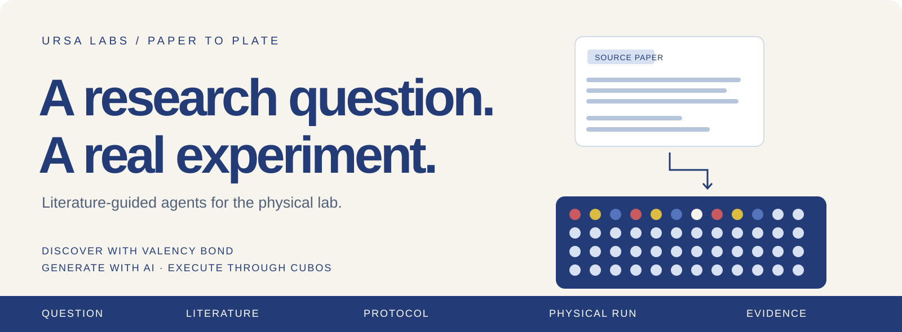
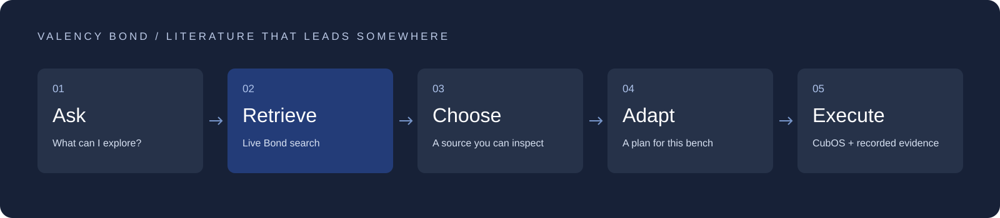
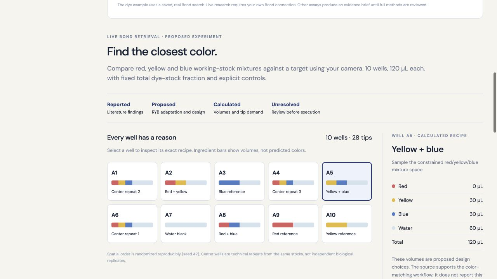

<div align="center">



### Can agents develop and run real-world experiments?

**Start with a paper. Or start with a question. Build an experiment you can inspect.**

[Valency Bond](docs/VALENCY_BOND.md) · [See the experiment](#from-literature-to-the-bench) · [Quick start](docs/GETTING_STARTED.md) · [Architecture](docs/ARCHITECTURE.md) · [Evidence & limits](docs/EVIDENCE.md) · [Cite this project](CITATION.cff)

[](docs/VALENCY_BOND.md)
[](https://github.com/Ursa-Laboratories/CubOS)
[](pyproject.toml)
[](docs/EVIDENCE.md)

</div>

---

Paper to Plate is an AI research workbench from **Ursa Labs**. It connects scientific literature, experiment design, liquid-handling protocols, and recorded laboratory evidence.

It began with a straightforward challenge: feed an agent a paper and see whether it could turn the method into a protocol. It grew into a larger question:

> **What can I discover with the lab I already have?**

Valency Bond supplies the research. AI helps interpret and adapt it. Deterministic code compiles the liquid-handling plan. CubOS owns execution. The result stays linked to its source, assumptions, and evidence.

## From literature to the bench


*Actual recorded hardware footage, compressed from approximately 20 minutes to 15 seconds. This is a replay, not a live feed or a measurement of liquid accuracy.*

| **10 wells** | **94 commands** | **Recorded evidence** |
|:---:|:---:|:---:|
| Red, yellow, blue, and water | Completed according to CubOS | Camera recording, run events, final image |

The color experiment used literature discovered through Bond to develop a small red/yellow/blue mixture screen. An operator-supervised run completed on the physical workcell. [Read the execution receipt →](docs/EVIDENCE.md#physical-color-mixture-run)

## Valency Bond: research that becomes an experiment



**Bond helps decide which experiment to build.** A question becomes a set of real papers; a selected method becomes a concrete design with controls, quantities, and explicit adaptations.

| What Bond contributes | What Paper to Plate does with it |
|---|---|
| **Search by scientific meaning** | Finds relevant methods from a research question, including work the user did not already have open. |
| **Identifiable, linked papers** | Keeps the chosen source visible beside the experimental plan. |
| **Structured literature results** | Supplies evidence to the AI layer and anchors supported method templates. |
| **Retrieval receipts** | Preserves the query, request identifier, returned papers, and live-versus-recorded mode. |

The integration uses **Valency's real MCP endpoint and OAuth sign-in**. Live retrieval and recorded examples are labeled separately. Numerical recipes are checked against reviewed methods and compiled with code; a search match is not treated as proof that an experiment will work.

**For the Valency prize track:** [integration walkthrough, actual calls, and evidence →](docs/VALENCY_BOND.md)

## Two experiments. One connected workflow.

### 01 / Bradford → a representative preparation workflow

A published protein assay became a **24-well colored-water demonstration**: six standard levels, one diluted unknown, and a separate water blank, each in triplicate.

Red stands in for the standard, yellow for the unknown, and blue for the prepared reagent. The design preserves the pipetting structure while making the substitutions visible. It does **not** measure protein concentration.

[Bradford example →](examples/bradford-color-demo/README.md) · [Published method →](https://pmc.ncbi.nlm.nih.gov/articles/PMC3164080/)

### 02 / Color matching → a physical mixture screen

Bond retrieved *Exploring Benchmarks for Self-Driving Labs using Color Matching*. We adapted its dye-and-camera workflow from CMYK to the available red/yellow/blue stocks.

The first round combines single-color references, pairwise mixtures, repeated center recipes, and a water blank. An operator-supervised physical run completed, with video and controller evidence retained. This is an initial mixture screen; calibrated color matching and automatic next-round optimization remain future work.

[Color experiment →](docs/DEMO.md#color-mixture-screen) · [Published benchmark →](https://arxiv.org/abs/2310.00510)

### 03 / Computer vision → observe what the robot actually does

A computer-vision layer detects pipette tips and visible liquid in recorded or live camera frames. Predictions can be inspected alongside the experiment, supporting work toward execution-error detection.

The detector has been adapted to the local camera and tested on recorded runs. It does not yet establish liquid volume, reliable error detection, or general accuracy across different liquids and lighting.

[Vision system →](docs/vision/README.md) · [Measured replay results →](docs/vision/local-liquid-replay.md)

## Every well has a reason



| Reported | Proposed | Calculated | Unresolved |
|---|---|---|---|
| What the source actually says | Equipment and demo adaptations | Volumes, dilution arithmetic, tips | What still needs a source or operator check |

These distinctions travel with the experiment. A model-generated plan, a passing software validator, and a successful controller run establish different things.

## Get started

**Requirements:** Python 3.11+ and a Node.js version supported by the bundled Vite release. See the [setup guide](docs/GETTING_STARTED.md) for model, Bond, and CubOS configuration.

```bash
git clone https://github.com/Ursa-Laboratories/PaperToPlate.git
cd PaperToPlate
./setup.sh

# Fresh checkout only: fill in the backend credentials and runtime paths.
cp .env.example .env
./start.sh
```

Open **http://127.0.0.1:8785/**. You can inspect the reference examples before configuring model access. Live generation uses the server-side Ollama configuration; live literature search uses **Connect Bond**.

> [!NOTE]
> Physical execution requires a commissioned CubOS station and operator-confirmed setup and loading. Starting this app or generating a draft does not start a robot run.

## What is established—and what comes next

| Established in the prototype | Still to establish |
|---|---|
| Live Bond retrieval and source-linked design | General feasibility ranking across arbitrary experiments and equipment |
| Typed liquid operations and deterministic compilation | A broad collection of independently verified paper-to-protocol examples |
| Offline volume, tip, and motion checks | Independent delivered-volume and assay-outcome measurements |
| Recorded physical execution of a color-mixture screen | Calibrated color matching and iterative optimization |
| Camera-specific tip/liquid detection and replay evidence | Reliable execution-error detection on independent runs |

Our next step is a **proper evaluation suite**: human-verified source methods, reviewed reference protocols, independently measured physical outcomes, and held-out camera data. [Evaluation plan and evidence boundaries →](docs/EVIDENCE.md)

## Explore the repository

| Start here | What you will find |
|---|---|
| [Documentation index](docs/README.md) | Guides organized by what you want to do |
| [Valency integration](docs/VALENCY_BOND.md) | Why Bond matters, MCP flow, provenance, live versus recorded |
| [Quick start](docs/GETTING_STARTED.md) | Installation, credentials, local runtime, troubleshooting |
| [Architecture](docs/ARCHITECTURE.md) | The boundary between AI, compiler, CubOS, and observations |
| [Demo guide](docs/DEMO.md) | Bradford, color mixing, and a concise judging walkthrough |
| [Evidence & evaluation](docs/EVIDENCE.md) | Verified results, limits, and the evaluation roadmap |
| [Example protocols](examples/bradford-workflow/README.md) | Source-specific liquid workflows and offline checks |
| [Vision training](docs/training.md) | Data, models, annotation, and validation requirements |

<details>
<summary><strong>For developers: verification and project structure</strong></summary>

```bash
.venv/bin/python -m pytest -q
npm --prefix frontend run build
```

The main environment may skip optional ML tests. Vision checks use the dedicated vision environment described in the vision guide. Historical check counts are recorded with their scope; they are not a substitute for running the current suite.

```text
src/paper_to_plate/    API, model adapter, compiler, validation and evidence
frontend/             React + TypeScript workbench
examples/             Reference protocols, setup snapshots and Bond receipts
research/             Source-linked extraction work and screened catalogues
docs/                 User guides, architecture, evaluation and media
```

Credentials, OAuth tokens, runtime uploads, model weights, and raw experiment recordings stay outside Git. See [third-party notices](THIRD_PARTY_NOTICES.md) for included research and software assets.

</details>

---

<div align="center">

**From a question, through the literature, to an experiment where every well has a reason.**

Built by [Ursa Labs](https://ursalabs.ai) · Literature through [Valency Bond](https://www.valency.io/bond/) · Execution through [CubOS](https://github.com/Ursa-Laboratories/CubOS)

</div>


The question-first workflow is available at `/?explore=1`; see [Explore a question](docs/question-explorer.md) for paper browsing, proposed setup and run behavior.
