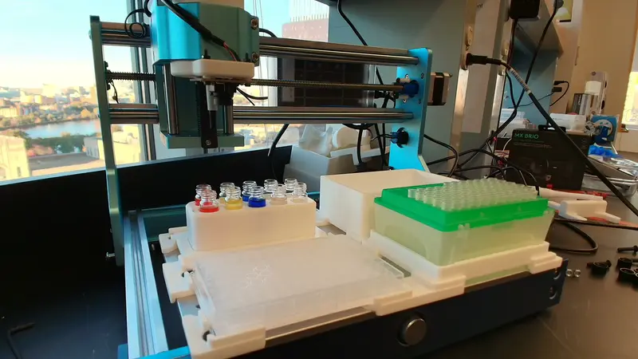

# Demo guide · Research you can watch become an experiment

[← Project](../README.md) · [Valency story](VALENCY_BOND.md) · [Evidence](EVIDENCE.md) · [Setup](GETTING_STARTED.md)

## A concise judging walkthrough

| Beat | Show | Explain |
|---|---|---|
| **01 · Ask** | A question and the available materials/equipment | “What can I explore with this bench?” |
| **02 · Find** | Live Bond results and a selected paper | The method has an inspectable source. |
| **03 · Adapt** | A plate layout, recipe quantities, and source/adaptation labels | The paper and local design choices remain distinct. |
| **04 · Prepare** | A loading sheet and native validation | Code checks the plan; an operator verifies the physical setup. |
| **05 · Run** | Recorded physical execution | CubOS owns movement and run state. |
| **06 · Inspect** | Run events, a final image, and vision predictions | Evidence is retained; performance claims require measurement. |

Keep live search, recorded examples, and hardware replay visibly labeled. A saved retrieval is useful for a reliable walkthrough, but it is not a new live search.

## Bradford preparation demo

**Question:** Can a published assay's liquid-handling structure become a robot-readable procedure?

The [Bradford example](../examples/bradford-color-demo/README.md) maps red to a standard surrogate, yellow to one unknown surrogate, blue to prepared reagent surrogate, and plain water to dilution/blank roles.

| Design | Full example |
|---|---|
| Standard levels | Six |
| Unknown | One, prepared at a proposed 1:10 dilution |
| Blank | Separate water-only wells |
| Replication | Three technical replicates per condition |
| Plate size | 24 used wells, 200 µL each |
| Tip requirement | 72 fresh tips |

A useful detail to show is the distinction between the **reagent-only zero standard** and the **water-only optical blank** in the selected Ernst/Zor method. The colored-water version preserves the preparation pattern without claiming protein chemistry or a quantitative Bradford result.

[Source method](https://pmc.ncbi.nlm.nih.gov/articles/PMC3164080/) · [Stock layout and executable example](../examples/bradford-color-demo/README.md)

## Color-mixture screen

**Question:** Which mixtures should we test with red, yellow, blue, and a camera?

The initial screen adapts the [Ginsburg et al. color-matching benchmark](https://arxiv.org/abs/2310.00510) to available RYB stocks. The paper uses CMYK; our mixture levels and recipe layout are local design choices.

- Three single-color references.
- Three pairwise mixtures.
- Three repeated center mixtures.
- One water blank.
- Ten wells, planned at 120 µL each.

*Recorded physical run, time-compressed from approximately 20 minutes. Controller completion does not establish delivered-volume or color accuracy.*

The recorded run completed **94 commands across 10 wells**. A final image and controller evidence were retained. The supporting [public summary](evidence/color-run-summary.json) reports the outcome and its limits.

## What computer vision adds

The observation layer detects pipette tips and visible liquid. Predictions are attached to the same source images and can be reviewed alongside the run. This supports development of execution-error detection; boxes alone do not prove liquid delivery, volume, or absence of errors.

The [camera-specific replay report](vision/local-liquid-replay.md) records small-sample results, missed detections, and a later operator-run observation. Do not present those counts as a broad accuracy benchmark.

## Before filming a new physical run

Use the actual station's commissioned setup and current inventory. Check source identities, source depths, empty destinations, fresh tips, waste, and the final protocol revision. Keep operator control in CubOS. Reconcile interrupted runs rather than replaying a draft blindly.

For a presentation without a physical run, use the bundled evidence media and say that it is recorded. Never represent a screen animation or predicted mixture color as an observed experimental result.

## Closing line

> From a question, through the literature, to an experiment where every well has a reason.
